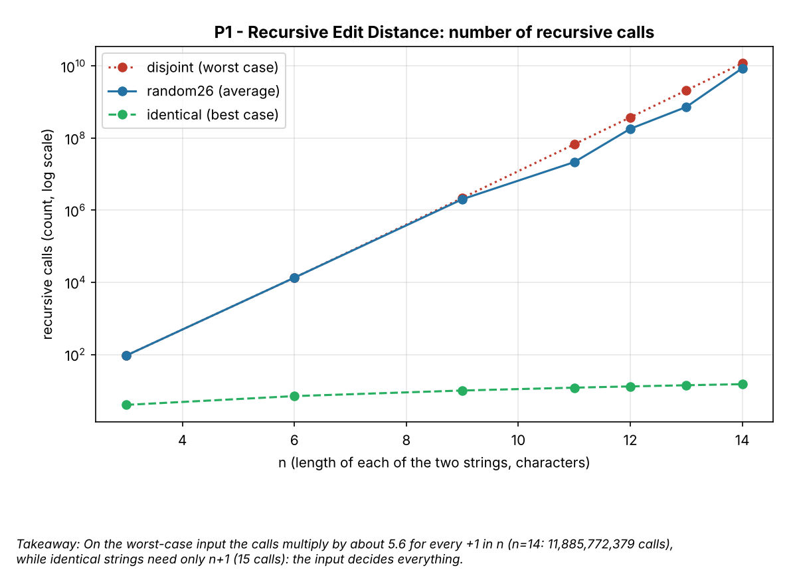
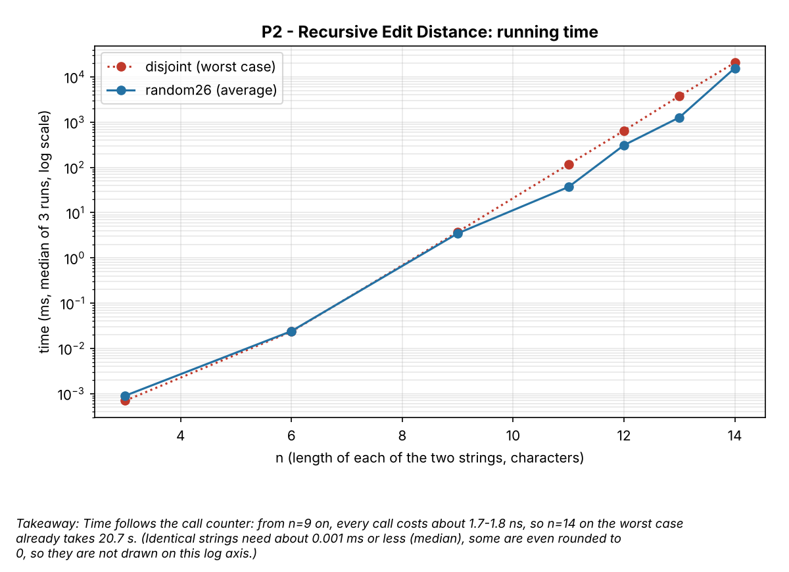
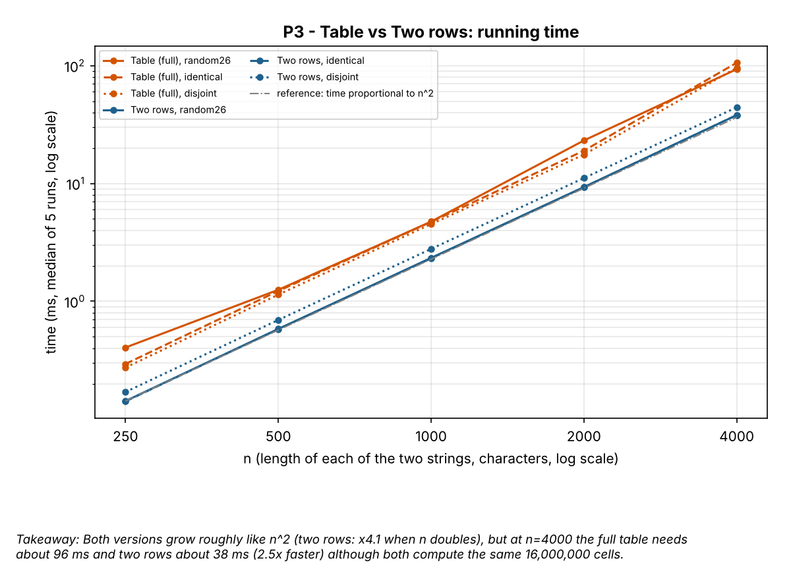
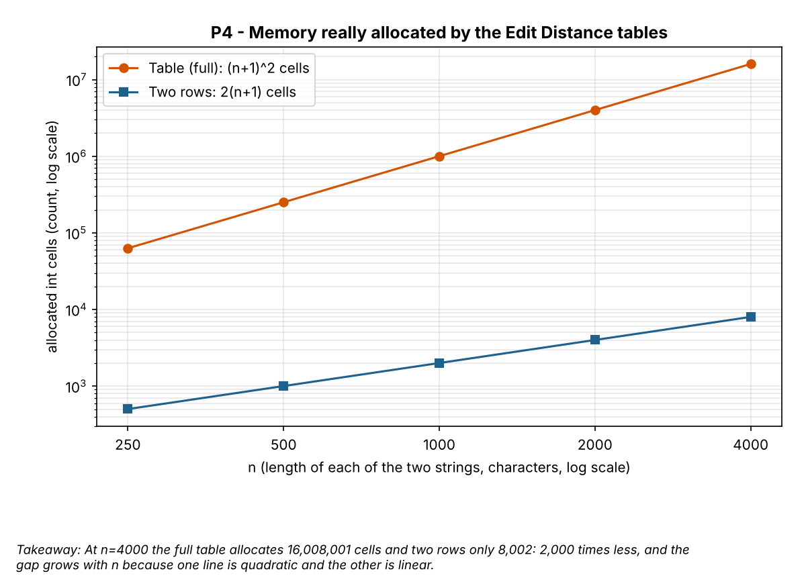
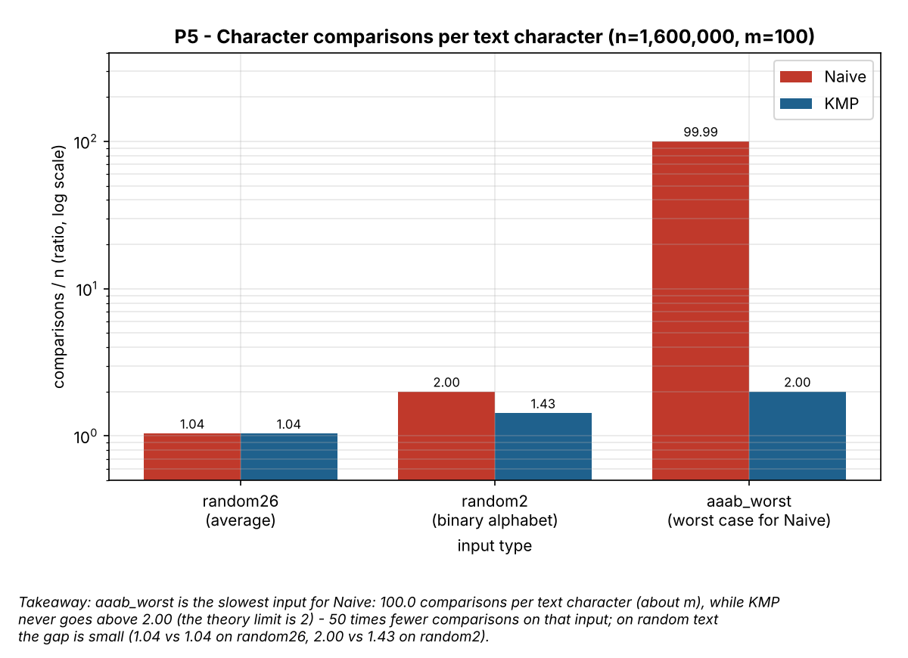
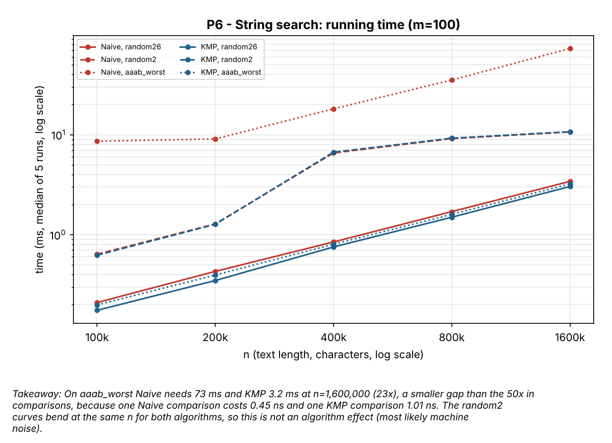
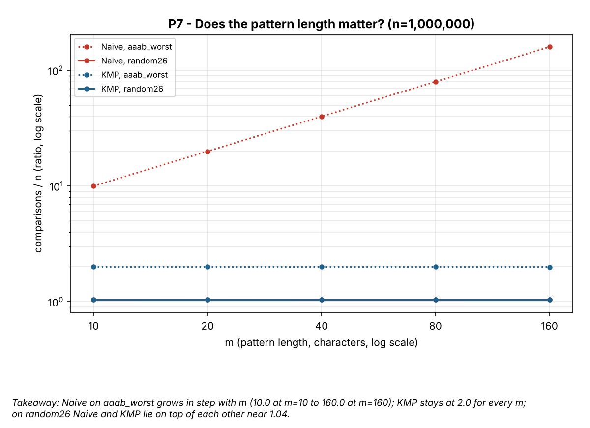

# Assignment 4 - Report: City Search & Spell-Check

Numbers come from `results/results.csv` (seed 42; Linux container, 1 vCPU Intel Xeon 2.30 GHz, OpenJDK 21).
Counters are identical on every run; times are medians of 3 runs (recursion) or 5 runs (everything else).

## Experiment Design Card

*(Written BEFORE the first run of the experiment. Predictions come from the theory of Lectures 8-9 and from a quick
paper estimate of the recursion tree.)*

| Card field | What I wrote |
|---|---|
| **Question** | **Edit Distance:** (1) Does the plain recursion really grow exponentially, and how much does the *kind of input* change its cost (best vs worst case)? (2) Do the table and the two-rows version both cost n·m, and how much memory does each one really allocate?  **String search:** (1) Does Naive reach about n·m comparisons on a bad input while KMP stays near n (never above 2n)? (2) Does Naive get slower when the pattern gets longer while KMP does not? |
| **Sizes (n)** | **Recursive ED:** n = 3, 6, 9, 11, 12, 13 (both strings have length n). In the worst case the number of calls grows about 5.6x for every +1 in n: n=12 is about 4·10^8 calls (seconds), n=13 about 2·10^9 (about 10 s) - that is the last size I am willing to wait for. Largest/smallest = 4.3.  **Table / Two rows:** n = 250, 500, 1000, 2000, 4000 (largest = 16x smallest). At n=4000 there are 16 million cells (table = about 64 MB), so a run takes tens of ms, not 0 ms and not minutes.  **Search:** text length n = 100 000, 200 000, 400 000, 800 000, 1 600 000 with pattern length m = 100 (16x). Extra sweep over the pattern: n = 1 000 000 and m = 10, 20, 40, 80, 160. |
| **Inputs** | **ED** - `random26`: two independent random strings over 26 letters, the "average" input. `identical`: b = a, BEST case for the recursion (last chars always match, one call per step). `disjoint`: a = "aaa...", b = "bbb...", WORST case for the recursion (nothing matches, 3 calls at every step). The table versions should not care which input they get - this is what `identical` and `disjoint` check.  **Search** - `random26`: random text over 26 letters, pattern cut from the text (typical text; mismatches show up at the first character). `random2`: random text over {a,b}, pattern cut from the text (many long partial matches, Naive goes back often). `aaab_worst`: text = "aaa...a", pattern = "aa...ab" - WORST case for Naive (each start costs m comparisons and fails at the last one). |
| **Metrics** | `time_ms` (median of 3 runs for the recursion, 5 runs for everything else, after a JIT warm-up) - what the user feels, but depends on the laptop.  `steps` - counted inside the algorithm: recursive calls (version A), computed cells (B, C), character comparisons (search). It is the cost that the theory talks about, and it does not depend on the machine.  `alloc_cells` - int cells really allocated by the DP versions (sum of array lengths): this is the memory question.  `lps_steps` - comparisons used to build the LPS array (KMP preprocessing), so that KMP is not "cheaper" only because the setup is hidden. |
| **Prediction** | **Recursive ED:** on `disjoint` the calls grow about 5.5x per +1 in n (a straight line on a log axis); on `random26` almost the same (26 letters, a match is rare); on `identical` exactly n+1 calls, a flat line near the bottom. Time follows the number of calls.  **Table vs Two rows:** `steps` = n·m exactly for both and for every input type; time grows about 4x when n doubles; both versions are close in time (two rows may be a bit faster because it touches less memory). `alloc_cells`: (n+1)^2 against 2(n+1), about 2000x less at n=4000.  **Search:** `random26`: Naive about 1.04·n comparisons, KMP about n - nearly the same. `random2`: Naive about 2·n, KMP between n and 2n. `aaab_worst`: Naive about m·n = 100·n comparisons, KMP about 2·n, so Naive should be much slower in time too. With the m sweep: Naive worst case grows linearly with m, Naive on random26 and KMP stay flat. |
| **Plots** | P1 - recursive calls vs n, log y, 3 inputs: *does the exponential growth appear, and does the input type matter?*  P2 - recursive time vs n, log y: *does time follow the counter?*  P3 - time of table vs two rows vs n: *do both grow like n·m and which one is faster?*  P4 - allocated cells vs n, log-log: *what do two rows really save?*  P5 - comparisons per text character (ratio steps/n) for Naive and KMP on each input, log y: *which input is the worst case and how much does KMP save?*  P6 - search time vs n, log y: *does the counter story agree with the clock?*  P7 - comparisons per text character vs pattern length m, log x: *does the cost depend on m?* |

### Changes to the card after the first run

1. **Recursion sizes: n = 14 was added** (sizes are now 3, 6, 9, 11, 12, 13, 14). My paper estimate said that n=13 would take
   about 10 s; it took 3.8 s (about 1.75 ns per call), so there was room for one more size, and the answer to "how large an n"
   became a measured number instead of a guess.
2. **One untimed warm-up run before every configuration.** In the first run some configurations had a very different time in
   run 1 and in run 5 (Naive on `aaab_worst`, n=200 000: 36 ms and 13 ms), which is the JIT compiler still working. The counters
   of the first and the second full run were identical; only the times changed.
3. Plot P2 shows only `disjoint` and `random26`: the time of `identical` is about 0.001 ms or less (some runs are rounded to 0), which cannot be drawn on a log axis.
4. Known limit of the design: `random26` uses **one** random pair per n (fixed seed), so the `random26` recursion curve is a single sample.

## Plots and results

**P1 - Recursive Edit Distance: number of recursive calls**

*On the worst-case input the calls multiply by about 5.6 for every +1 in n (n=14: 11,885,772,379 calls), while identical strings need only n+1 (15 calls): the input decides everything.*

**P2 - Recursive Edit Distance: running time**

*Time follows the call counter: from n=9 on, every call costs about 1.7-1.8 ns, so n=14 on the worst case already takes 20.7 s. (Identical strings need about 0.001 ms or less (median), some are even rounded to 0, so they are not drawn on this log axis.)*

**P3 - Table vs Two rows: running time**

*Both versions grow roughly like n^2 (two rows: x4.1 when n doubles), but at n=4000 the full table needs about 96 ms and two rows about 38 ms (2.5x faster) although both compute the same 16,000,000 cells.*

**P4 - Memory really allocated by the Edit Distance tables**

*At n=4000 the full table allocates 16,008,001 cells and two rows only 8,002: 2,000 times less, and the gap grows with n because one line is quadratic and the other is linear.*

**P5 - Character comparisons per text character (n=1,600,000, m=100)**

*aaab_worst is the slowest input for Naive: 100.0 comparisons per text character (about m), while KMP never goes above 2.00 (the theory limit is 2) - 50 times fewer comparisons on that input; on random text the gap is small (1.04 vs 1.04 on random26, 2.00 vs 1.43 on random2).*

**P6 - String search: running time (m=100)**

*On aaab_worst Naive needs 73 ms and KMP 3.2 ms at n=1,600,000 (23x), a smaller gap than the 50x in comparisons, because one Naive comparison costs 0.45 ns and one KMP comparison 1.01 ns. The random2 curves bend at the same n for both algorithms, so this is not an algorithm effect (most likely machine noise).*

**P7 - Does the pattern length matter? (n=1,000,000)**

*Naive on aaab_worst grows in step with m (10.0 at m=10 to 160.0 at m=160); KMP stays at 2.0 for every m; on random26 Naive and KMP lie on top of each other near 1.04.*

## Prediction vs Result

### Edit Distance

| Prediction | Result | Match? |
|---|---|---|
| Recursion on `disjoint`: about 5.5x more calls per +1 in n. | 5.59x, 5.60x, 5.62x for n = 12, 13, 14 (11.9 billion calls at n=14). | yes |
| Recursion on `random26`: almost the same as `disjoint`. | 35% of the `disjoint` calls at n=13 and 73% at n=14; the curve is jumpy (x4.0 from 12 to 13, x11.9 from 13 to 14). | **no** |
| Recursion on `identical`: exactly n+1 calls. | n+1 for every n (15 calls at n=14). | yes |
| Recursion time follows the number of calls. | 1.7-1.8 ns per call for every n from 9 to 14. | yes |
| Table and Two rows: `steps` = n·m for every input. | 16 000 000 cells for both at n=4000, for all three inputs. | yes |
| Table and Two rows: time grows about 4x when n doubles. | Two rows: x4.1. Table: x4.0 to x5.6 (n=2000 to 4000, depends on the input), noisier. | yes, table noisier |
| Two rows "may be a bit faster". | 2.5x faster at n=4000 (38 ms against 96 ms). | **bigger than predicted** |
| Memory: (n+1)^2 against 2(n+1), about 2000x less. | 16 008 001 against 8 002 cells = 2000x. | yes |

**Why `random26` is different:** when the last two characters are equal, the recursion makes *one* call instead of three. In a random
string over 26 letters this happens rarely, but when it happens close to the start of the recursion (near the ends of the strings) it cuts away a
huge part of the tree. So the number of calls depends on *where* the matches are, not only on n, and I wrongly expected a curve almost equal to `disjoint`.
**Why the table is slower than two rows:** both do exactly the same number of cell computations, so the difference is not the work. The table touches
about 64 MB (16 million ints) and two rows touch about 32 KB; most likely the small rows stay in the CPU cache. I did not measure cache misses, so this is an
explanation, not a proof. Another small surprise: Two rows is about 16% slower on `disjoint` than on the other inputs (44 ms against 38 ms at n=4000)
with identical counters; I did not investigate it.

### String search

| Prediction | Result | Match? |
|---|---|---|
| `random26`: both about 1.04·n comparisons. | Naive 1.04, KMP 1.04 comparisons per text character. | yes |
| `random2`: Naive about 2·n, KMP between n and 2n. | Naive 2.00, KMP 1.43. | yes |
| `aaab_worst`: Naive about m·n, KMP about 2·n. | Naive 99.99 (m=100), KMP 2.00. | yes |
| `aaab_worst`: Naive "much slower" in time. | 73 ms against 3.2 ms (23x). | yes, but the gap is smaller than the 50x in comparisons |
| m sweep: Naive worst grows linearly with m, the rest is flat. | Naive 10.0 -> 160.0 for m = 10 -> 160; KMP 2.00 and Naive on `random26` 1.04 for every m. | yes |
| (not predicted) KMP is faster in time when it makes fewer comparisons. | On `random2` KMP needs 29% fewer comparisons, but the times are the same (10.7 ms and 10.7 ms at n=1.6M). | surprise |

**Why the time gap is smaller than the counter gap:** a Naive comparison costs 0.45 ns and a KMP comparison 1.01 ns; the likely reason is that a KMP step has an extra array lookup and more branches
(I did not measure it). The counter says how much work was done, the clock says how fast one unit of work is on this machine; I need both.

## Short answers

**Which input made your string search slowest, and why does it do that?**
`aaab_worst` (text `aaa...a`, pattern `aa...ab`) made Naive slowest. At every start position Naive matches m-1 letters `a`, fails on the final `b`, throws
everything away and starts again one position later, so each text character is read about m times. That gives 99.99 comparisons per character for m=100 (about n·m in total)
and 73 ms at n=1.6M, against 3.4 ms on `random26`, where a start position usually fails at the first character. KMP stays at 2.00 comparisons per character on the same input,
because after a mismatch it moves the pattern with the LPS array and never moves back in the text.

**How large an n could the recursive Edit Distance handle, and what stopped it?**
In the worst case I measured up to n=14: 11.9 billion calls and 20.7 s. I stopped there on purpose: the calls grow x5.6 per +1 in n, so (extrapolating, not measured)
n=15 would need about 2 minutes, n=17 about 1 hour and n=20 about 180 hours. What stops the recursion is time, not memory: the depth is at most 2n frames. The reason is repeated work:
for n=14 there are only 15·15 = 225 different (i, j) states, but they are computed 11.9 billion times, because nothing is stored. The limit depends on the input: on identical strings the
recursion needs only n+1 calls.

**What do you gain and what do you lose when you use two rows instead of the full table?**
I gain memory: 8 002 cells instead of 16 008 001 at n=4000 (2000x less, O(m) instead of O(n·m)), and in my measurements also about 2.5x less time (38 ms against 96 ms), most likely because
two rows fit in the cache. The number of computed cells does not change (n·m for both). I lose the ability to recover *which* edits were used, because that needs walking back from the
last cell through the whole table; two rows give only the number. The code is also a little harder to read (two arrays that swap roles).

**If you had to choose one string search for your city platform, which one and why?**
KMP. Its cost is at most 2n comparisons whatever the text is, and log files are exactly where repeated patterns (the same line or error code many times) can appear, which is the situation where Naive
costs n·m (50x more comparisons in my worst case). On ordinary text KMP loses almost nothing: 1.04 against 1.04 comparisons per character and 3.0 ms against 3.4 ms on `random26`.
The price is an extra array of m integers and a few more lines of code.

## One paragraph on time

The measured times go from about 0.001 ms (recursion on identical strings) to 20.7 s (recursion, n=14, worst case), and inside one configuration they were usually within a few percent of each other, but not always:
the full table at n=4000 ranged from 74 to 107 ms over the three inputs and five runs, and in the first full run the same configuration of Naive on `aaab_worst` took 36 ms in one run and 13 ms in another (JIT warm-up).
The `random2` curves of both search algorithms bend at the same n, and a first run of the whole experiment put the bend at different sizes, so that is the machine and not the algorithm. All this is the reason why
time is not my only evidence: the counters (calls, cells, comparisons) were identical in every run, they do not depend on the laptop, and they explain *why* a time is what it is (for example
1.7 ns per call, or n·m cells in both DP versions); the clock only tells how fast one unit of work is on this machine.
